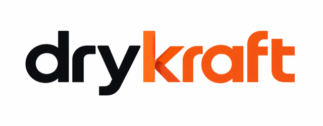
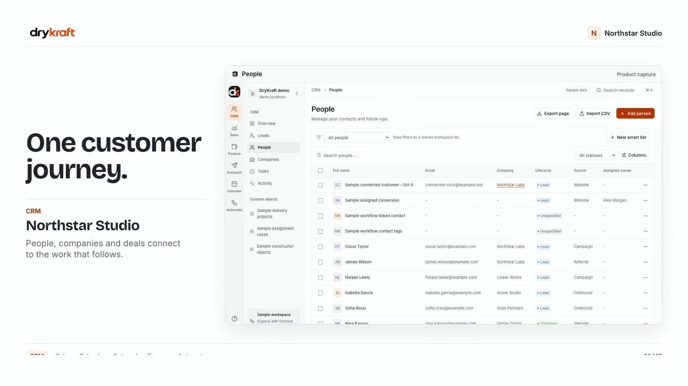

# DryKraft

DryKraft is a self-hostable workspace for customer relationships, sales,
finance, outreach, scheduling, and automation. Create a lead, follow the
connected deal, schedule the next conversation, and turn the opportunity into
an invoice without re-entering the customer’s details.

Built by [Engineer Master Solutions Pvt Ltd](https://emasterlabs.com/).

[Website](https://drykraft.com) · [Product docs](https://drykraft.com/docs) ·
[API reference](https://drykraft.com/docs/api) · [Contribute](CONTRIBUTING.md) ·
[License](LICENSE)

## Watch the product tour

[](https://drykraft.com/#product-tour)

Follow a lead through CRM, sales, calendar booking, outreach, invoicing, and automation. The tour also covers email warmup, the transactional outbox, and workspace administration. [Play on the website with English captions and chapters](https://drykraft.com/#product-tour) · [Open the MP4](https://drykraft.com/videos/drykraft-product-tour.mp4)

## What’s included

| Area | Capabilities |
| --- | --- |
| CRM and sales | People, companies, leads, tasks, related records, CSV import, smart lists, custom objects and fields, sales pipelines, and dashboards |
| Finance | Invoices and PDFs, purchase orders, received payment records, expenses and approvals, reusable templates, and multiple currencies |
| Outreach | Email, SMS, AI voice, and WhatsApp campaigns and sequences, consent and suppression, delivery activity, reply handling, and email warmup limits |
| Calendar | Month and agenda views, availability and booking links, Google Calendar and Outlook connections |
| Automation | Versioned visual workflows, triggers and actions, retries and execution history, and a transactional outbox |
| Administration and APIs | Workspace roles, teams and locations, MFA, scoped integration keys, signed webhooks, platform administration, and reseller tools |

Email warmup ramps a mailbox’s sending allowance for reviewed outreach.
Finance records payments already received and keeps amounts in their original
currency. External delivery, calendar sync, and hosted billing need the
appropriate provider accounts and configuration.

## Run locally

**Prerequisites:** Git, **Node.js 22.12 or later** with npm, PostgreSQL, and Redis.
Start PostgreSQL and Redis first. Initial setup needs a local PostgreSQL user
with permission to create a database and roles.

```sh
git clone https://github.com/emasterlab/drykraft.git
cd drykraft
npm ci
npm run setup
npm run dev
```

Open [localhost:5173](http://localhost:5173). Create an account and workspace,
or choose **Explore the sample workspace** to browse fictional records when
local demo access is enabled.

Setup generates a private `.env`, initializes PostgreSQL and applies the
migrations. If setup cannot authenticate to your local PostgreSQL instance,
set `LOCAL_DATABASE_ADMIN_URL` in your shell using your own local administrator
connection, then rerun `npm run setup`. Use [.env.example](.env.example) as a
settings reference. Configure provider accounts later if you need email
delivery, SMS, calling, WhatsApp, calendar sync, or hosted billing.

### Set up with Claude Code, Codex, or another coding agent

Clone the repository and open the `drykraft` folder. If you have the CLI
installed, run `claude` for [Claude Code](https://code.claude.com/docs/en/quickstart)
or `codex` for [Codex](https://developers.openai.com/codex/cli/) from that
folder. You can also open the folder in a desktop coding agent or IDE
assistant with terminal access. Paste this prompt into the session:

```text
Help me run DryKraft locally. Read README.md, package.json, and scripts/setup.mjs.
Check that Node.js 22.12+, npm, PostgreSQL, and Redis are available. If a
prerequisite is missing, show me the install or startup steps for my OS.
Use a local development database and Redis instance. If a .env already exists,
check that its service URLs are local before running setup. Keep credentials
in the terminal or private environment, and do not print or commit them.
Run npm ci, npm run setup, and npm run dev. If PostgreSQL needs a different
admin connection, explain how I can set LOCAL_DATABASE_ADMIN_URL myself.
Check that http://localhost:5173 opens and /api/health reports that PostgreSQL
and Redis are connected. Tell me how to open the sample workspace or create
my own, and how to stop the development processes.
```

### First-run checks

| Symptom | What to check |
| --- | --- |
| Database setup fails | Start PostgreSQL and confirm that the local admin can create databases and roles. |
| Health check is unavailable | Make sure the API and Redis are running. If you changed the API port, check `PORT` in your local `.env`. |
| The browser cannot open the app | Keep `npm run dev` running and check that port 5173 is free. |
| The sample workspace button is missing | Set `DEMO_ENABLED=true` for local development, run setup to seed the sample data, and restart the dev processes. |

### Configure WhatsApp AI replies

This feature is optional. The person running DryKraft sets a chat-completions
endpoint, model name, and their own API key in the server’s private `.env`.
For [60db Vyas](https://docs.60db.ai/features/llm-chat), use:

```dotenv
OUTREACH_LLM_URL=https://api.60db.ai/v1/chat/completions
OUTREACH_LLM_MODEL=vyas
OUTREACH_LLM_API_KEY=
```

Fill the last line with your own 60db API key, then restart the API and worker.
You can also use a different HTTPS chat-completions provider that supports
Bearer authentication and streaming responses. In DryKraft, open **Outreach →
Connections**, select your verified WhatsApp connection, and preview a reply
with fictional text before enabling automation. Previewing does not send a
WhatsApp message. When replies are enabled, the selected provider receives the
inbound text and your business instructions.

## Development

| Command or path | Purpose |
| --- | --- |
| `npm run dev` | Run the Vite client, API and workflow worker |
| `npm run build` | Type-check and build the app and static website into `dist/` |
| `npm start` | Serve the built site and API |
| `npm run worker` | Run background workflow processing |
| `npm run db:migrate` | Inspect pending migrations, then pass `-- --apply` to apply them |
| `npm test` | Run the repository tests with disposable local services |
| `src/`, `server/`, `public/` | React client, Node.js API/workers, and public assets |
| `server/schema.sql`, `server/migrations/` | PostgreSQL schema and ordered migrations |

DryKraft uses React, Vite, Node.js, Express, PostgreSQL, and Redis. The API
serves the workspace app and the generated website. PostgreSQL stores
workspace records and their events. Workers process queued work separately.

## Contributing

Read [CONTRIBUTING.md](CONTRIBUTING.md) for local development, issue reports,
and pull requests. Report security issues privately to support@drykraft.com.

## License

DryKraft is **source-available for personal, noncommercial use** under the
[DryKraft Personal and Noncommercial Use License](LICENSE). For commercial
licensing, contact support@drykraft.com. Third-party dependencies and fonts
retain their own licenses.
